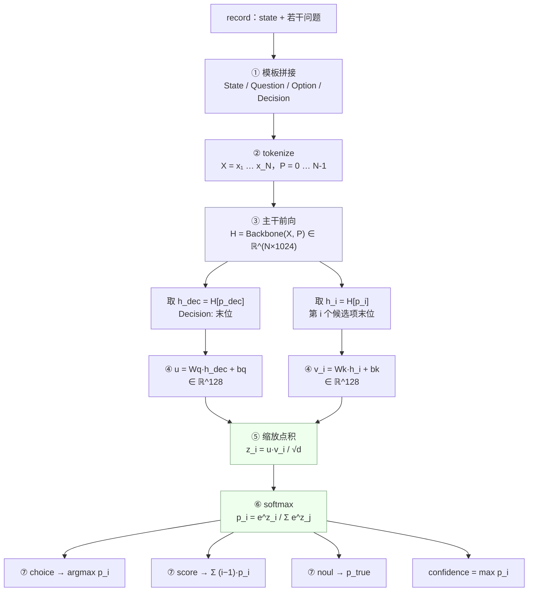

> 通过网盘分享的文件：JEV 模型原理介绍
链接: https://pan.baidu.com/s/17oIayhgsb7TtR3rr_XIqXQ?pwd=5ybe 提取码: 5ybe 
视频及代码资料，链接过期请联系我

> 项目代码
https://github.com/JayChen123/jev-model-introduction.git

用本地轻量化模型 `Qwen3.5-0.8B-JEV` 演示 JEV 的调用方式。纯脚本，不是服务，不需要 API Key。

## JEV 和聊天模型的区别

| | 聊天模型 | JEV 决策模型 |
|---|---|---|
| 输入 | 一段文本 | `state` + 若干**类型化问题** |
| 输出 | 生成的文本 | 每个问题的**概率分布** |
| 取结果 | 正则 / JSON 解析，可能解析失败 | 直接读字段，argmax 一定是合法候选 |
| 候选项 | 固定，改分类要重新训练 | **运行时给定**，随时增删改 |
| 适合 | 对话、写作 | 分类、路由、分流、打分、判定 |

一句话：JEV 不"说话"，只输出可以直接写进 `if/else` 的数字。

## 三种接口任务（原语）

| 类型 | 用途 | 返回字段 |
|---|---|---|
| `choice` | 从若干候选中选一个（分类、路由、分流） | `choice`、`probabilities`、`confidence` |
| `score` | 在有序量表上打分（紧急度、满意度、风险分级） | `score`、`level`、`probabilities`、`confidence` |
| `noul` | 判断命题真假（是否退款、是否需要人工） | `noul`（为真的概率）、`probabilities` |

三者可以放在**同一个请求**里混用，共享同一份 `state`。

## 文件说明

```
jev_model.py        核心引擎：加载模型 + 三种原语的实现（自包含，约 250 行，教学重点）
demo_primitives.py  三种原语的基础调用示例 + 置信度路由 + 动态候选
demo_intent.py      实战：用 JEV 做三分类意图识别
trace_jev.py        把一次决策的中间量全部打印出来（配合「数学原理 → 实际例子」）
pyproject.toml      独立环境依赖
```

## 运行

```bash
cd _05_jev
uv run python demo_primitives.py    # 三种接口任务
uv run python demo_intent.py        # 意图识别
uv run python trace_jev.py          # 打印完整计算过程（隐藏状态 / 点积 / softmax）
uv run python jev_model.py          # 引擎自测
```

首次运行会加载约 0.8B 的模型。Apple GPU（MPS）上单次请求约几十毫秒。

## 环境说明

本目录使用**独立的 uv 环境**（`_05_jev/.venv`），不共用仓库根目录的 `../.venv`。

原因：本地 JEV 模型的 backbone 是 `qwen3_5_text` 架构，需要 `transformers==5.5.3`；
而根目录 `pyproject.toml` 锁定的是 `transformers==4.57.3`（`_01_llama-factory` /
`_03-evaluator` / `_04_vllm` 都在用 4.x）。两者无法共存，所以隔离。

模型路径默认为 `/Users/chan/projects/models/Qwen3.5-0.8B-JEV`，
可用环境变量 `JEV_MODEL_DIR` 覆盖。

## 输入格式

```python
record = {
    "state": "客户被重复扣款两次，要求立刻退款。",   # 字符串 / dict / list 均可
    "questions": {
        "route": {                                  # 问题 ID，随便起，会原样出现在结果里
            "type": "choice",
            "instructions": "这个工单应该交给哪个团队处理？",
            "criteria": {                           # {候选ID: 候选描述}
                "billing": "账单、发票、退款相关",
                "other": "以上都不是",
            },
        },
        "urgency": {
            "type": "score",
            "instructions": "这个工单的紧急程度如何？",
            "criteria": ["可以排队", "优先处理", "立即人工介入"],   # 有序，从低到高
        },
        "refund_requested": {
            "type": "noul",
            "instructions": "客户是否明确提出了退款请求？",
        },
    },
}

answers = engine.predict(record)
# answers["route"]["choice"]         -> "billing"
# answers["urgency"]["score"]        -> 1.45（期望档位，可落在两档之间）
# answers["refund_requested"]["noul"] -> 0.90（为真的概率）
```

## 模型架构

### 1. 先讲基础：语言模型为什么不能直接拿来做决策

一个因果语言模型（Causal LM）在最后一层拿到隐藏状态 $h_T \in \mathbb{R}^{H}$，
经 LM head 投影到词表，得到的是**下一个 token 的分布**：

$$
p(\text{next token} \mid \text{context}) = \mathrm{softmax}(W_{\text{lm}} h_T), \quad W_{\text{lm}} \in \mathbb{R}^{V \times H}
$$

它的"分类能力"藏在"下一个 token 是谁"里面。想拿一个类别，只能：

1. 让模型把类别名**生成**成文本；
2. 再写正则或 JSON 解析去取。
   模型可能输出 `"我认为是 billing"`、`"类别：Billing"`，也可能编出一个不存在的类别。

而且类别是隐式编码在 $W_{\text{lm}}$ 的权重里的——**换一套类别就得重新训练**。

### 2. JEV 换了一个问法

不做 next-token 预测，而是直接问：**给定上下文 $x$，候选集 $C$ 中哪个候选最合适？**

关键设计是：**候选也当成文本，送进同一个 backbone**。然后训练两个线性投影，
把"问题"和"候选"分别映射到同一个向量空间，用**点积**衡量匹配度：

- 传统分类头：$C$ 个类别 → $C \times H$ 个参数，类别变了要重训；
- JEV 决策头：只学"怎么把问题编码成查询向量、把候选编码成键向量"，参数量 $2(Hd + d)$，
  **与候选数量完全无关**。候选集每次请求临时给定即可。

这就是官方说的 dynamic candidates。

### 3. 整体结构

```
record（state + 若干问题）
   │   ① 按固定模板拼成文本，tokenize
   ▼
token ids + position ids
   │   ② 前向传播
   ▼
Qwen3.5-0.8B 文本主干（~0.8B，本 artifact 中不含 LM head / vision tower / MTP）
   │   ③ 取两类位置的隐藏状态，H = 1024 维
   ▼
决策头 Wq / Wk（共 262,400 参数，head_dim = 128）
   │   ④ 缩放点积 + softmax
   ▼
每个候选的概率分布
```

### 4. Backbone：Qwen3.5 文本主干

取自 `backbone/config.json` 的实际配置：

| 配置项 | 取值 | 说明 |
|---|---|---|
| `architectures` | `Qwen3_5TextModel` | 需要 `transformers >= 5.x`（4.x 不识别此架构） |
| `hidden_size` | 1024 | 隐藏维度 $H$ |
| `num_hidden_layers` | 24 | 共 24 层 |
| `layer_types` | 18 × `linear_attention` + 6 × `full_attention` | 混合注意力，`full_attention_interval: 4` |
| `num_attention_heads` | 8（`head_dim` 256） | 全注意力层的 Q 头 |
| `num_key_value_heads` | 2 | GQA，4 个 Q 头共享 1 组 KV |
| `linear_num_key_heads` / `linear_value_heads` | 16 / 16（dim 128） | 线性注意力层，`linear_conv_kernel_dim: 4` |
| `intermediate_size` | 3584（`hidden_act: silu`） | FFN 中间层 |
| `vocab_size` | 248320 | 词表大小 |
| `attn_output_gate` | `true` | 注意力输出带门控 |
| `partial_rotary_factor` | 0.25（`rope_theta: 1e7`） | 只对 1/4 维度施加 RoPE，`mrope_section: [11, 11, 10]` |
| `tie_word_embeddings` | `true` | 词嵌入与输出层共享权重 |
| `max_position_embeddings` | 262144 | 主干能力上限（但本 artifact 只用到 1024，见下） |

两点值得说明：

- **为什么是混合注意力**：24 层里有 6 层全注意力、18 层线性注意力。
  线性注意力层把 KV 缓存压缩成固定大小的状态，长文本下显存和算力不随长度线性增长。
  运行时若装了 `flash-linear-attention` 会走融合算子，没装就回退到 torch 实现
  （就是运行时那行 `The fast path is not available ...` 提示，不影响结果）。
- **本 artifact 移除了什么**：LM head、vision tower、MTP（多 token 预测）组件都不在里面。
  所以这个模型**不能拿来生成文本**，`AutoModelForCausalLM`、vLLM、Ollama、GGUF 都加载不了它。

### 5. 决策头

只有两个线性投影，权重存在 `head.safetensors`：

| 张量 | 形状 |
|---|---|
| `query.weight` | `[128, 1024]` |
| `query.bias` | `[128]` |
| `key.weight` | `[128, 1024]` |
| `key.bias` | `[128]` |

参数量 $2 \times (H \cdot d + d) = 2 \times (1024 \times 128 + 128) = 262{,}400$。
相对 0.8B 的主干可以忽略不计，这正是"轻量"的来源：**能力主要来自主干，
决策头只学一个极低秩的匹配空间**。

## 数学原理

下面按数据实际流经的顺序推一遍，最后合起来就是完整公式。

### 记号

| 符号 | 含义 |
|---|---|
| $x$ | `state`（上下文） |
| $q$ | 问题说明（`instructions`） |
| $C = \{c_1, \dots, c_n\}$ | 候选集（由 `criteria` 在运行时给出） |
| $H$ | 主干隐藏维度，$= 1024$ |
| $d$ | 决策头维度 `head_dim`，$= 128$ |
| $p_{\text{dec}}$ | `Decision:` 最后那个 token 的位置 |
| $p_i$ | 第 $i$ 个候选项描述最后那个 token 的位置 |

### 计算流程图



留意两处并行的分支汇合：**backbone 只跑一次**，但要在 $n+1$ 个位置取隐藏状态
（1 个决策位 + $n$ 个候选位）；两条投影线（query / key）在点积处才汇合。

### 第一步：编码成 token 序列

按固定模板拼接，**注意候选项的边界是刻意留出来的**：

```
State:
<x>
Question (choice):
<q>
Option:
<c_1>          ← 位置 p_1（该候选项最后一个 token）
Option:
<c_2>          ← 位置 p_2
⋮
Decision:      ← 位置 p_dec
```

得到 token id 序列 $X = [x_1, \dots, x_N]$，位置编码就是行内顺序递增的 $P = [0, 1, \dots, N-1]$。

### 第二步：主干前向

$$
H_{\text{hid}} = \mathrm{Backbone}(X, P) \in \mathbb{R}^{N \times H}
$$

### 第三步：取两个位置的隐藏状态

$$
h_{\text{dec}} = H_{\text{hid}}[p_{\text{dec}}] \in \mathbb{R}^{H}, \qquad
h_i = H_{\text{hid}}[p_i] \in \mathbb{R}^{H}
$$

为什么取"最后一个 token"？因为因果注意力下，位置 $t$ 的隐藏状态聚合的是 $1..t$ 的全部信息。
候选项末尾那个位置的表示，就等于"读完了这个候选项描述"的语义摘要；
`Decision:` 末尾那个位置的表示，等于"读完了问题并准备做决定"的查询意图。

### 第四步：投影到决策空间

$$
u = W_q h_{\text{dec}} + b_q \in \mathbb{R}^{d}, \qquad
v_i = W_k h_i + b_k \in \mathbb{R}^{d}
$$

$u$ 是**决策查询**（由问题和上下文产生），$v_i$ 是**候选键**（由候选描述产生）。

### 第五步：缩放点积注意力

$$
z_i = \frac{u \cdot v_i}{\sqrt{d}}, \qquad i = 1, \dots, n
$$

除以 $\sqrt{d}$ 是为了控制点积的方差——$d$ 维向量点积的方差随 $d$ 线性增长，
不缩放的话 $z$ 的尺度会随维度漂移，softmax 容易饱和成一个 one-hot。

### 第六步：softmax 归一化

$$
p_i = \frac{\exp(z_i)}{\sum_{j=1}^{n} \exp(z_j)}
$$

### 完整式子

把上面串起来，模型的全部计算就是：

$$
\boxed{\;
p_i = \frac{\exp\!\left( \dfrac{(W_q h_{\text{dec}} + b_q)^{\top} (W_k h_i + b_k)}{\sqrt{d}} \right)}
{\sum_{j=1}^{n} \exp\!\left( \dfrac{(W_q h_{\text{dec}} + b_q)^{\top} (W_k h_j + b_k)}{\sqrt{d}} \right)}
\;}
$$

其中 $h_{\text{dec}} = \mathrm{Backbone}(X,P)[p_{\text{dec}}]$，
$h_i = \mathrm{Backbone}(X,P)[p_i]$。

用 $d = 128$ 代入，缩放因子 $\sqrt{d} \approx 11.31$。

### 第七步：按题型读出结果

三种题型**共用上面同一个分布**，区别只在怎么读：

| 题型 | 候选键 | 主答案 | 公式 |
|---|---|---|---|
| `choice` | `criteria` 的字典键 | $\arg\max_i p_i$ | $\hat{c} = c_{i^*},\; i^* = \arg\max_i p_i$ |
| `score` | `"0"`, `"1"`, … | 期望档位 | $\hat{s} = \sum_{i=1}^{n} (i-1)\, p_i$ |
| `noul` | `"false"`, `"true"` | 为真的概率 | $\hat{y} = p_{\text{true}}$ |

三种题型的置信度统一取：

$$
\text{confidence} = \max_i p_i
$$

注意 `score` 用的是**期望**而不是 argmax：分布 $[0.02, 0.55, 0.43]$ 的期望是
$0 \times 0.02 + 1 \times 0.55 + 2 \times 0.43 = 1.41$，落在第 1 档和第 2 档之间，
比直接取 argmax 保留更多信息。

### 实际例子：一次完整的计算过程

下面把 `demo_primitives.py` 里的工单分流问题完整跑一遍，每一步的**真实数值**都列出来。
这些数不是编的，跑 `uv run python trace_jev.py` 就能复现。

**设定**：一个 4 候选的 `choice` 问题（3 个业务团队 + 1 个兜底项）。

#### 步骤 1–2：模板拼接与 token 化

送进模型的**就是这段纯文本**，没有别的：

```
State:
客户反馈：订单被重复扣款两次，已经等了三天，要求立刻退款，否则就投诉。
Question (choice):
这个工单应该交给哪个团队处理？
Option:
billing: 账单、发票、退款相关
Option:
account: 账号登录、资料修改相关
Option:
technical: 程序缺陷、接口集成相关
Option:
other: 以上都不是
Decision:
```

token 化后 $N = 92$，两类关键位置：

| 记号 | 位置 | 含义 |
|---|---:|---|
| $p(\text{billing})$ | 53 | 该候选项描述的末位 token |
| $p(\text{account})$ | 66 | 同上 |
| $p(\text{technical})$ | 79 | 同上 |
| $p(\text{other})$ | 88 | 同上 |
| $p_{\text{dec}}$ | 91 | `Decision:` 的末位，也就是整个序列的最后一个 token |

#### 步骤 3：取隐藏状态（每个 1024 维）

| 位置 | 前 4 维 | $\lVert h \rVert$ |
|---|---|---:|
| $h_{\text{dec}}$ | −6.8828, 1.4980, −0.7451, 15.0781 | 30.11 |
| $h(\text{billing})$ | −6.8672, 1.6816, −0.9321, 15.2188 | 31.18 |
| $h(\text{account})$ | −6.8672, 1.7168, −0.8721, 15.0234 | 31.00 |
| $h(\text{technical})$ | −6.8672, 1.7021, −0.9170, 15.0234 | 31.02 |
| $h(\text{other})$ | −6.8633, 1.7021, −1.0117, 15.0156 | 31.13 |

**这里是整个链路最反直觉的一步**：5 个向量几乎一模一样。前 4 维的差异在小数点后一位，
范数全在 31 上下。这是必然的——它们都是"刚读完一行 `Option: ...`"的表示，
区别仅仅在于那一行写的是什么。主干把语义压得很稠密，
**真正的"决策"还没发生**。

#### 步骤 4：投影到 128 维决策空间

| 向量 | 前 4 维 | $\lVert \cdot \rVert$ |
|---|---|---:|
| $u = W_q h_{\text{dec}} + b_q$ | 0.0412, 0.0747, 0.1401, **−3.5742** | 18.55 |
| $v(\text{billing}) = W_k h + b_k$ | 0.9663, 1.2520, 0.8452, **−0.2893** | 8.01 |
| $v(\text{account})$ | 0.9653, 1.2637, 0.9072, **0.3328** | 7.65 |
| $v(\text{technical})$ | 0.9966, 1.2373, 0.8818, **0.2539** | 7.63 |
| $v(\text{other})$ | 1.0127, 1.2539, 0.8628, **0.0758** | 7.64 |

投影之后，第 4 维上开始出现肉眼可见的分化（−0.289 / 0.333 / 0.254 / 0.076）。
但请注意：**4 个候选键的模长依然几乎相同**（7.63 ~ 8.01）。
区别在**方向**上，不在长度上——这正是用点积（衡量方向一致性）
而不是用距离或范数的原因。

#### 步骤 5：缩放点积（$\sqrt{d} = \sqrt{128} \approx 11.3137$）

| 候选 | $u \cdot v$（原始点积） | $z = u \cdot v / \sqrt{d}$ |
|---|---:|---:|
| billing | 46.5000 | **4.1094** |
| other | 11.9141 | **1.0527** |
| technical | −6.3086 | **−0.5576** |
| account | −10.8516 | **−0.9590** |

**缩放的作用在这一步看得最清楚**：原始点积跨度约 57（46.5 → −10.9），
除以 11.3137 之后压到约 5（4.11 → −0.96）。

如果省掉这个 $\sqrt{d}$：$\exp(46.5)$ 与 $\exp(11.9)$ 的比值约 $e^{34.6} \approx 10^{15}$，
softmax 会直接饱和成一个近似 one-hot 的分布——梯度消失，而且输出失去了"概率"的含义
（只剩下"赢家"）。注意这一步只是把尺度拉到合理区间，**排序完全没变**。

#### 步骤 6：softmax

$$
p_i = \frac{\exp(z_i)}{\sum_j \exp(z_j)}
$$

| 候选 | $z_i$ | $\exp(z_i)$ | $p_i$ |
|---|---:|---:|---:|
| billing | 4.1094 | 60.90864 | **0.940965** |
| other | 1.0527 | 2.86548 | **0.044268** |
| technical | −0.5576 | 0.57257 | **0.008846** |
| account | −0.9590 | 0.38328 | **0.005921** |
| | | $\sum = 64.72997$ | $\sum = 1.000000$ |

拿计算器验一遍：

$$
\frac{60.90864}{64.72997} = 0.940965 \quad \checkmark
$$

指数函数的作用是**放大差距**：$z$ 上 billing 只领先 other 约 3.06，
到了概率上就是 0.941 对 0.044——领先 21 倍。softmax 是一个"赢者通吃"的放大器。

#### 步骤 7：读结果

| 字段 | 值 |
|---|---|
| `choice` | `billing`（argmax） |
| `confidence` | `0.940965`（= max $p_i$） |
| `probabilities` | `{billing: 0.941, other: 0.044, technical: 0.009, account: 0.006}` |

和 `demo_primitives.py` 打印的结果逐位一致。

#### 复盘：1024 维 → 128 维 → 4 个分数 → 4 个概率

| 阶段 | 维度 | 发生了什么 |
|---|---|---|
| 主干输出 | 5 × 1024 | 语义已经"懂"了，但 5 个向量几乎不可区分 |
| 决策头投影 | 5 × 128 | 维度降低，候选之间开始分化 |
| 点积 | 4 | 坍缩成一个分数，且差距被拉到 57 的跨度 |
| 缩放 | 4 | 尺度归一到合理区间（跨度约 5），排序不变 |
| softmax | 4 | 转成概率，差距进一步放大成 21 倍 |

整条链路上**真正的决策只发生在最后两步**（点积 + softmax），
参数量也只有 262,400。前面 0.8B 的参数负责的其实是"把文本读懂"。
这也解释了为什么这个模型能做得这么轻：它不需要生成能力，
只需要把语义**编码成可比较的向量**。

### 两个由归一化导出的推论

因为 $\sum_i p_i = 1$ 是硬约束，有两个必须知道的工程后果：

1. **候选集是耦合的**。增删任意一个候选，$n$ 变了，**所有**候选的概率都会变——
   不是因为模型"改了主意"，而是分母变了。所以概率不能跨候选集比较。
2. **`confidence` 是相对的**。三个候选里拿 0.9 和十个候选里拿 0.9，含义完全不同。
   阈值必须在固定候选集下、用你自己的标注数据标定。

## 执行模式与训练目标

### `rows` 执行

`decision_config.json` 里 `execution: "rows"`、`option_isolation: false`。
含义是：**每个问题单独编码成一行**，每行 = 完整的 `state` + 该问题的候选项 + `Decision:`。

$$
\text{第 } k \text{ 行的序列} = \underbrace{[x_1 \dots x_L]}_{\text{state}} \Vert \underbrace{[q^{(k)}, c_1^{(k)}, \dots, c_{n_k}^{(k)}, \text{Decision:}]}_{\text{第 } k \text{ 个问题的分支}}
$$

后果有两条：

- **隔离性**：每个问题看不到其他问题的候选项，互不干扰（多问题共享 `state` 的语义，
  但各自独立判断）。官方也建议每个问题写成**原子的单维度判断**，不要在一个问题里塞多个条件。
- **代价**：`state` 被重复计算了 $n_{\text{questions}}$ 次。所以问题数增加时，
  **响应时间会增长**（这与官方 API 的说法不同——API 侧做了并行）。
  本例的实现逐行前向，逻辑最清楚；要提速就把多行拼成 batch 一次前向。

### 训练目标

本模型是**知识蒸馏**得到的：教师模型（`typesafe/jev-1.13`）给出完整的**软分布** $y$，
学生模型学的不是 argmax 标签，而是整个分布。官方给出的两个目标函数是：

$$
\mathcal{L}_{\text{CE}} = -\sum_{i=1}^{n} y_i \log p_i
\qquad
\mathcal{L}_{\text{Brier}} = \sum_{i=1}^{n} (p_i - y_i)^2
$$

学完整分布（而不是只学标签）是这是一个"概率模型"而不是"分类器"的前提——
`score` 的期望值、`noul` 的阈值用法，都依赖分布的形状而不只是最大值。

### 复杂度小结

| 项 | 复杂度 |
|---|---|
| 决策头参数量 | $2(Hd + d)$，与候选数 $n$ 无关 |
| 单行序列长度 | $L + \lvert q \rvert + \sum_i \lvert c_i \rvert + O(1)$，上限 1024 |
| 全注意力层开销 | 行内 $O(N^2)$（24 层里 6 层） |
| 线性注意力层开销 | 行内 $O(N)$（24 层里 18 层） |
| 一次请求总开销 | 约 $n_{\text{questions}}$ 次独立前向 |

## 工程使用建议

**置信度路由**（JEV 最有价值的用法）：

```python
conf = answers["route"]["confidence"]
if conf >= 0.85:    # 自动执行
elif conf >= 0.60:  # 转人工复核
else:               # 升级给大模型 / 人工
```

**写问题的三条原则**（官方建议）：

1. 一个问题只问一件事（原子单维度判断）。复杂逻辑拆成多个问题，在代码里组合。
2. `choice` 的候选里要有兜底项（如 `other`），否则模型会被迫在都不合适的选项里选一个。
3. 候选描述要具体、互斥——模型就是靠这些文字区分类别的，描述越清楚分得越准。

## 注意事项

- **`confidence` 不等于准确率**。它只表示概率分布有多集中，阈值必须用你自己的
  标注数据去标定，不能照搬示例里的 0.85 / 0.60。
- **候选集会影响概率**。同一句话换一套候选，原有候选的概率也会变。
- **输入上限 1024 token**。超长会直接报错而不是静默截断（截断会把候选项切掉）。
- 输出的 `score` 是**概率加权的期望档位**，可以落在两档之间，比 argmax 更平滑。
- 首次运行会打印 `The fast path is not available ...` —— 这是 backbone 的线性注意力层
  没用上 `flash-linear-attention` 加速库、回退到 torch 实现的提示，不影响结果。

## 正确性验证

`jev_model.py` 是重新实现的（不依赖官方 `jev-inference` 包），已与官方实现做过逐项对比：
同一个 record 上三种题型的概率分布最大偏差 `2.7e-07`（float32 舍入级），结果一致。

官方实现：<https://github.com/joyfoxai/jev-inference>

## 模型来源与局限

本模型是 `Qwen3.5-0.8B` 蒸馏得到的决策模型，学生模型会复现教师模型的偏好和错误。
官方 README 明确说明：90.40% 的指标是**与教师模型的一致性**，不是真人标注的准确率。
用于高风险决策前，需要在自有标注数据上做验证并保留人工兜底。

